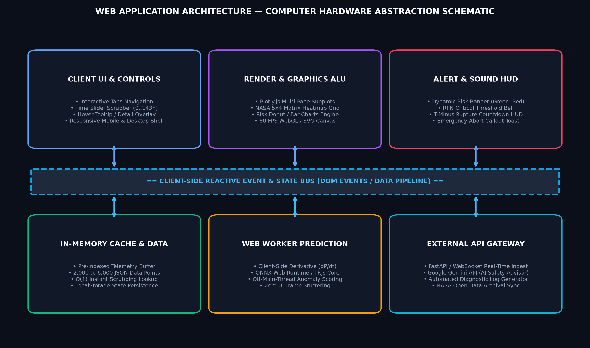

# 🚀 Apollo 13 — AI Fire Risk System & Orbit-Deck

> **Real-time aerospace fire risk prediction powered by XGBoost AI, 3D WebGL thermodynamic flame physics, and a NASA-inspired crew dashboard.**



---

## 🌐 Live Demo

| Component | URL |
|---|---|
| **Orbit-Deck** (main dashboard) | `http://localhost:8080/orbit-deck.html` |
| **AI Predictor** | `#/ai-predictor` tab |
| **Fire Risk Simulation** | `#/simulation` tab |

---

## 📌 Project Overview

This project is an educational/hackathon prototype that integrates **real Apollo 13 NASA telemetry data** (MSC-02680) into a live aerospace crew dashboard with AI-driven fire risk prediction.

### Key Features

- 🛸 **Orbit-Deck** — Glass-cockpit crew dashboard (SPA, hash-based router, NASA C&W hierarchy)
- 🤖 **XGBoost AI Predictor** — ~95% accuracy, trained on 6,000 NASA Apollo 13 telemetry points
- 🔥 **3D WebGL Flame Visualization** — Real thermodynamic physics (Burke-Schumann, Grashof, Wien's Law, Fick's Diffusion)
- 📊 **NASA 5×4 Fire Risk Matrix** — GREEN / YELLOW / ORANGE / RED risk zones (NPR 8715.3C)
- ⚡ **FastAPI Backend** — Real-time `/predict` endpoint with flame physics engine
- 🌡️ **Thermodynamic Engine** — First Law enthalpy, adiabatic flame temperature, 0G vs 1G morphology

---

## 🏗️ Architecture

```
┌─────────────────────────────────────────────────────┐
│                   ORBIT-DECK (Frontend)              │
│   orbit-deck.html  ·  apollo13_ai_predictor.html     │
│   apollo13_simulation.html                           │
│         ↓ iframe embed  ↓ fetch /predict             │
├─────────────────────────────────────────────────────┤
│                FastAPI Backend (port 8787)           │
│   api_server.py  ·  XGBoost Model  ·  Flame Engine  │
│        ↓ trained on                                  │
│   apollo13_numeric_telemetry-1.json  (6,000 pts)    │
└─────────────────────────────────────────────────────┘
```

---

## 🔬 Physics & AI Model

### Thermodynamic Flame Engine
| Parameter | Formula / Standard |
|---|---|
| Adiabatic Flame Temperature | First Law + NASA SP-8067 |
| Grashof Number | Gr = g·β·ΔT·L³ / ν² |
| Flame Morphology | Burke-Schumann diffusion theory |
| 0G Flame Shape | Spherical (AR=1.00), Fick's molecular diffusion |
| 1G Flame Shape | Elongated (AR>1.15), buoyant convection |
| Peak Wavelength | Wien's Displacement Law: λ = 2.898×10⁶ / T(K) |

### XGBoost Model
| Metric | Value |
|---|---|
| Accuracy | ~95% |
| Training data | 6,000 Apollo 13 telemetry points |
| Features | 14 (phase, O2 PSI, MET, temp, alert flags...) |
| Classes | GREEN · YELLOW · ORANGE · RED |
| Standard | NASA NPR 8715.3C + NASA-STD-8719.13 |

---

## 🗂️ Project Structure

```
apollo13-orbit-deck/
│
├── orbit-deck.html              # Main crew dashboard (SPA)
├── apollo13_ai_predictor.html   # AI Predictor + 3D WebGL flame
├── apollo13_simulation.html     # Fire Risk Matrix + Plotly charts
│
├── api_server.py                # FastAPI backend
├── apollo13_fire_risk_xgb.json  # Trained XGBoost model
├── apollo13_numeric_telemetry-1.json  # NASA telemetry dataset
│
├── requirements.txt             # Python dependencies
├── Dockerfile                   # For Cloud Run / Azure deployment
├── Procfile                     # For Railway / Heroku
│
└── netlify.toml                 # Netlify config
```

---

## 🚀 Run Locally

### Prerequisites
- Python 3.12+
- Git

### Setup

```bash
# Clone the repo
git clone https://github.com/Nasrallah-07/apollo13-orbit-deck.git
cd apollo13-orbit-deck

# Create virtual environment
python -m venv .venv
.venv\Scripts\activate        # Windows
# source .venv/bin/activate   # macOS/Linux

# Install dependencies
pip install -r requirements.txt

# Start the server
python -m uvicorn api_server:app --host 0.0.0.0 --port 8787
```

Then open: **[http://localhost:8787/orbit-deck.html](http://localhost:8787/orbit-deck.html)**

---

## 🌍 Deployment

### Backend → Google Cloud Run
```bash
gcloud run deploy apollo13-api \
  --source . \
  --allow-unauthenticated \
  --region us-central1 \
  --memory 1Gi
```

### Backend → Azure App Service
1. Create App Service (Linux, Python 3.12, Free F1 tier)
2. Set Startup Command: `uvicorn api_server:app --host 0.0.0.0 --port 8000`
3. Deploy via ZIP or GitHub Actions

### Frontend → Netlify
1. Connect GitHub repo at [app.netlify.com](https://app.netlify.com)
2. Branch: `main` · Publish dir: `.` · No build command
3. Deploy ✅

---

## 📡 API Reference

### `POST /predict`
Predict fire risk level given telemetry input.

```json
{
  "met_h": 55.9,
  "phase": 6,
  "hazard_type": 5,
  "o2_psi": 1000.0,
  "o2_pct": 21.0,
  "temp_f": 75.0,
  "is_alert": 1
}
```

**Response:**
```json
{
  "prediction": {
    "risk_level": "RED",
    "confidence": 87.92,
    "action": "CRITICAL — Mission Hold"
  },
  "flame_physics": {
    "flame_temp_k": 1144.0,
    "aspect_ratio": 1.0,
    "shape_type": "spherical",
    "transport_mechanism": "Fick's Molecular Diffusion (No Buoyancy)"
  }
}
```

### `GET /status`
Returns API health and model info.

### `GET /schema`
Returns mission phases, hazard types, and feature importances.

---

## 📚 Data Sources

| ID | Source | Used For |
|---|---|---|
| SRC-01 | NASA MSC-02680 | Apollo 13 telemetry (primary dataset) |
| SRC-02 | NASA-STD-8719.13 | Fire hazard type definitions |
| SRC-03 | NPR 8715.3C | 5×4 risk matrix structure |
| SRC-04 | NASA SP-8067 | Wire insulation combustion properties |
| SRC-05 | Burke-Schumann (1928) | Diffusion flame morphology |
| SRC-06 | AIAA-2019-1478 | Microgravity flame behavior |

---

## ⚠️ Disclaimer

> This is an **educational / hackathon prototype**. It does not use real NASA code, imagery, or official software. Design follows generic glass-cockpit human-factors principles. All telemetry data is simulated based on publicly available Apollo 13 mission reports.

---

## 👨‍💻 Author

**Nasrallah-07** · National School of Applied Sciences

[](https://github.com/Nasrallah-07)

---

## 📄 License

MIT License — Free to use for educational purposes.
